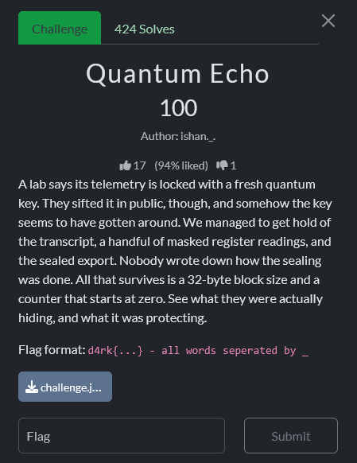

# Quantum Echo



**Flag:** `d4rk{quantum_echo_reuse_breaks_the_pad}`

Challenge cung cấp file `challenge.json`, chứa 160 cặp giá trị `(x, z)`, 8 mẫu hiệu chuẩn, quantum transcript, contact trace và ciphertext.

Phân tích `controller_model` cho thấy hệ thống sử dụng hai phép biến đổi 32-bit: `fold_tap`, `walk_tap`. Kết quả được kết hợp với hai mask bí mật, trạng thái echo và một calibration pad.

Vì có rất nhiều cặp input/output, hướng tiếp cận phù hợp là tìm cách biểu diễn các phép tính thành hệ phương trình trên GF(2).

## Recovering rotation parameters

Theo mô tả, fold word được tính bằng:

`F(x) = x XOR (ROL32(x,a) AND ROL32(x,b))`

Walk word:

`W(x) = ROL32(x,c)`

Thử lần lượt các giá trị quay từ 0 đến 31, đối chiếu với toàn bộ 8 calibration probes.

Kết quả:

- Fold rotations: `(5, 11)`
- Walk rotation: `7`

Do đó, ta đã biết hoàn toàn phép biến đổi áp dụng cho mỗi input `x`.

## Recovering secret masks using GF(2)

Mỗi observation có một bit đầu ra `z`, được tính từ fold-mask parity, trạng thái echo sau cập nhật và calibration-pad bit.

Bộ nhớ echo ban đầu là `e0`, sau đó cập nhật bằng parity giữa walk mask và walk word.

Gọi `C_i` là XOR cộng dồn của các walk word từ hàng đầu tiên tới hàng `i`.

Nhờ tính chất tuyến tính của parity, phương trình đầu ra được rút gọn thành:

`z_i = parity(s & F(x_i)) XOR parity(t & C_i) XOR e0 XOR q[i mod 16]`

Trong đó `s` và `t` là hai mask 32-bit, còn `q` là pad 16-bit.

Ta có tổng cộng 81 biến nhị phân: 32 bit cho `s`, 32 bit cho `t`, một bit `e0` và 16 bit `q`.

Từ 160 observations, xây dựng ma trận và sử dụng Gaussian elimination trên GF(2).

Ban đầu, hệ chỉ đạt rank 80/81. Nguyên nhân là việc đảo đồng thời `e0` và toàn bộ bit `q` không làm thay đổi output.

## Exploiting the quantum transcript

Kiểm tra quantum transcript cho thấy sample 0 chứa một audit tap đặc biệt:

`source = register_seed_contact_A`

`reported_bit = 1`

Đây là bit tiết lộ từ contact A, tương ứng `q[0] = 1`.

Bổ sung phương trình này vào hệ sẽ loại bỏ bất định còn lại. Hệ đạt rank 81/81 và có nghiệm duy nhất:

`s = 0x1d0cc456`

`t = 0xccc78639`

`e0 = 0`

`q = 1010010010100001`

Nghiệm được kiểm tra lại với tất cả 160 observations và cho kết quả chính xác.

## Breaking the seal

Dựa trên `seal_record.field_order` và các compatibility vectors, thuật toán niêm phong sử dụng SHA-256 để sinh dòng khóa từ một chuỗi ASCII chứa các tham số bí mật và counter 32-bit big-endian.

Chuỗi material sau khi khôi phục:

`1d0cc456:ccc78639:0:1010010010100001`

Với mỗi block, keystream được tính:

`SHA256(material || counter_u32_BE)`

Ciphertext được giải mã bằng phép XOR với các block keystream liên tiếp.

Vì ciphertext dài 39 bytes, cần hai SHA-256 digest, mỗi digest 32 bytes, với counter bắt đầu từ 0.

## Script:
```
import argparse
import hashlib
import json
from pathlib import Path

MASK32 = (1 << 32) - 1


def rol32(value: int, shift: int) -> int:
    shift %= 32
    return ((value << shift) | (value >> (32 - shift))) & MASK32


def parity(value: int) -> int:
    return value.bit_count() & 1


def calibrate(probes: list) -> tuple:
    """Recover the two fold rotations and the single walk rotation."""
    samples = [
        (int(p['input'], 16), int(p['fold_word'], 16), int(p['walk_word'], 16))
        for p in probes
    ]
    walks = [
        c for c in range(32)
        if all(rol32(x, c) == w for x, _f, w in samples)
    ]
    folds = [
        (a, b) for a in range(32) for b in range(a + 1, 32)
        if all((x ^ (rol32(x, a) & rol32(x, b))) == f
               for x, f, _w in samples)
    ]
    if len(walks) != 1 or len(folds) != 1:
        raise ValueError(f'Non-unique calibration: walks={walks}, folds={folds}')
    return folds[0][0], folds[0][1], walks[0]


def contact_cycle(trace_rows: list) -> list:
    """Find the shortest contact period explicitly supported by the trace."""
    rows = sorted(trace_rows, key=lambda r: r['observation_index'])
    if [r['observation_index'] for r in rows] != list(range(len(rows))):
        raise ValueError('The supplied pad-contact trace must begin at row 0.')
    labels = [r['contact'] for r in rows]
    candidates = [
        n for n in range(1, len(labels) + 1)
        if all(label == labels[i % n] for i, label in enumerate(labels))
    ]
    cycle = labels[:min(candidates)]
    if len(set(cycle)) != len(cycle):
        raise ValueError('Expected a distinct contact for each cycle position.')
    if len(labels) < 2 * len(cycle):
        raise ValueError('Need two observed contact cycles to justify repetition.')
    return cycle


def solve_gf2(equations: list, n_vars: int) -> tuple:
    """Solve linear equations over GF(2): list[(coefficient_bitset, RHS)]."""
    pivots = {}
    mask = (1 << n_vars) - 1

    for coeff, rhs in equations:
        augmented = coeff | ((rhs & 1) << n_vars)
        while augmented & mask:
            active = augmented & mask
            pivot_col = (active & -active).bit_length() - 1
            if pivot_col not in pivots:
                pivots[pivot_col] = augmented
                break
            augmented ^= pivots[pivot_col]
        else:
            if augmented >> n_vars:
                raise ValueError('Inconsistent GF(2) system; check model/order/pad cycle.')

    if len(pivots) != n_vars:
        raise ValueError(f'Underdetermined GF(2) system: rank {len(pivots)}/{n_vars}')

    solution = 0
    for pivot_col in sorted(pivots, reverse=True):
        row = pivots[pivot_col]
        other_vars = (row & mask) & ~(1 << pivot_col)
        bit = ((row >> n_vars) & 1) ^ parity(other_vars & solution)
        solution |= bit << pivot_col

    if any(parity(coeff & solution) != rhs for coeff, rhs in equations):
        raise ValueError('Internal solver error: reconstructed bits do not satisfy all rows.')
    return solution, len(pivots)


def get_seed_leaks(events: list) -> list:
    """Only register_seed_contact_* audits constrain q; test_detector does not."""
    leaks = []
    for ev in events:
        if ev['event'] == 'audit_tap' and ev.get('source', '').startswith('register_seed_contact_'):
            label = ev['source'][len('register_seed_contact_'):]
            leaks.append((label, int(ev['reported_bit'])))
    if not leaks:
        raise ValueError('No seed-contact audit leak; echo/pad global polarity is ambiguous.')
    return leaks


def generate_keystream(material: str, length: int) -> bytes:
    result = bytearray()
    for counter in range((length + 31) // 32):
        result.extend(hashlib.sha256(
            material.encode('ascii') + counter.to_bytes(4, 'big')
        ).digest())
    return bytes(result[:length])


def main() -> None:
    parser = argparse.ArgumentParser(description='Recover Quantum Echo CTF flag')
    parser.add_argument('challenge', nargs='?', default='challenge.json', type=Path)
    parser.add_argument('-o', '--output', type=Path, help='Optionally write recovered flag to file')
    args = parser.parse_args()

    data = json.loads(args.challenge.read_text(encoding='utf-8'))
    reg = data['register']
    a, b, c = calibrate(reg['controller_calibration']['probes'])
    labels = contact_cycle(reg['pad_contact_trace']['rows'])
    label_to_pos = {label: i for i, label in enumerate(labels)}
    n_pad = len(labels)
    n_vars = 65 + n_pad  # 32 bits s, 32 bits t, 1 bit e0, n_pad bits q

    observations = reg['observations']
    equations = []
    cumulative_walk = 0
    for row_index, obs in enumerate(observations):
        x = int(obs['x'])
        z = int(obs['z'])
        fold_word = x ^ (rol32(x, a) & rol32(x, b))
        cumulative_walk ^= rol32(x, c)
        q_index = label_to_pos[labels[row_index % n_pad]]
        coeff = (
            fold_word
            | (cumulative_walk << 32)
            | (1 << 64)
            | (1 << (65 + q_index))
        )
        equations.append((coeff, z))

    # The observable rows alone have a 1-dimensional ambiguity:
    #   (e0, q[0], ..., q[15]) -> (e0 XOR 1, q[0] XOR 1, ..., q[15] XOR 1).
    # The source="register_seed_contact_A" audit at sample 0 supplies q[A]=1.
    leaks = get_seed_leaks(data['quantum_transcript']['event_log'])
    for label, bit in leaks:
        equations.append((1 << (65 + label_to_pos[label]), bit))

    solution, rank = solve_gf2(equations, n_vars)
    s = solution & MASK32
    t = (solution >> 32) & MASK32
    e0 = (solution >> 64) & 1
    q = ''.join(str((solution >> (65 + j)) & 1) for j in range(n_pad))

    # The calibration vectors pin down SHA-256, the ASCII material format,
    # and the 4-byte big-endian counter. They are checked rather than guessed.
    vectors = data['seal_record']['compatibility_vectors']
    for v in vectors:
        test = hashlib.sha256(
            v['material_ascii'].encode('ascii')
            + int(v['counter_u32']).to_bytes(4, 'big')
        ).hexdigest()
        if test != v['digest_hex']:
            raise ValueError('SHA-256/counter interpretation failed a compatibility vector')

    material = f'{s:08x}:{t:08x}:{e0}:{q}'
    ciphertext = bytes.fromhex(data['sealed_flag'])
    key = generate_keystream(material, len(ciphertext))
    plain = bytes(c ^ k for c, k in zip(ciphertext, key))
    try:
        flag = plain.decode('ascii')
    except UnicodeDecodeError as exc:
        raise ValueError(f'Decrypted bytes are not ASCII: {plain.hex()}') from exc
    if not (flag.startswith('d4rk{') and flag.endswith('}')):
        raise ValueError(f'Invalid-looking flag: {flag!r}')

    print(f'Fold rotations  : ({a}, {b})')
    print(f'Walk rotation   : {c}')
    print(f'Contact cycle   : {"".join(labels)} (length {n_pad})')
    print(f'Rank            : {rank}/{n_vars} ({len(equations)} equations)')
    print(f's               : 0x{s:08x}')
    print(f't               : 0x{t:08x}')
    print(f'e0              : {e0}')
    print(f'q               : {q}')
    print(f'Key material    : {material}')
    print(f'Ciphertext bytes: {len(ciphertext)}')
    print(f'Flag            : {flag}')
    if args.output:
        args.output.write_text(flag + '\n', encoding='utf-8')
        print(f'Saved           : {args.output}')


if __name__ == '__main__':
    main()
```

Flag: d4rk{quantum_echo_reuse_breaks_the_pad}
