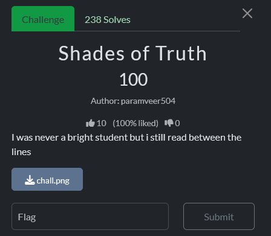
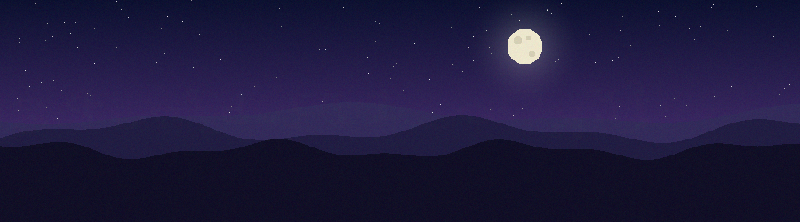
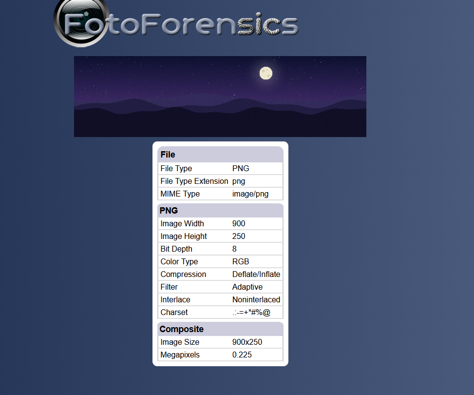
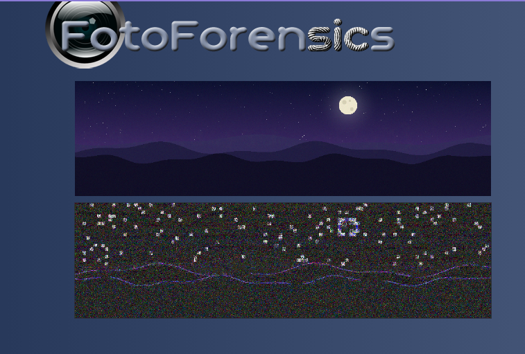
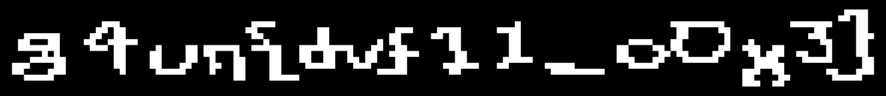

# Shades of Truth

**Flag:** `d4rk{ascii_l0v3}`

Challenge cung cấp 1 ảnh bầu trời sao đêm với hint "read between the lines"

## Phân tích ảnh
Phân tích `Medata` cho thấy bức ảnh có sử dụng Charset: `.:-=+*#%@`. Đây là bộ ký tự thường dùng để biểu diễn sắc độ bằng ASCII art.

Tiếp tục phân tích ảnh,, ta thấy các đốm sao được sắp xếp rất kì lạ.

Liên tưởng lại hint ban đầu của challenge: "read between the lines", mình thử nối các điểm đó với nhau thì ra được hình sau:

Từ ảnh, ta có thể đọc được g4un{dvfll_o0y3}, đây là flag được mã hóa bằng Caesar Cipher, sau khi giải mã ta được

Flag: `	d4rk{ascii_l0v3}`