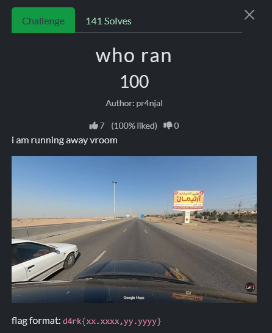
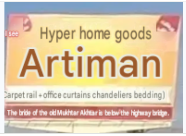
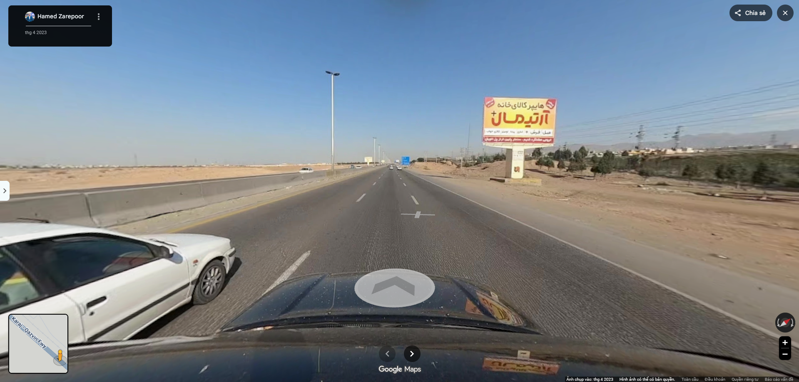
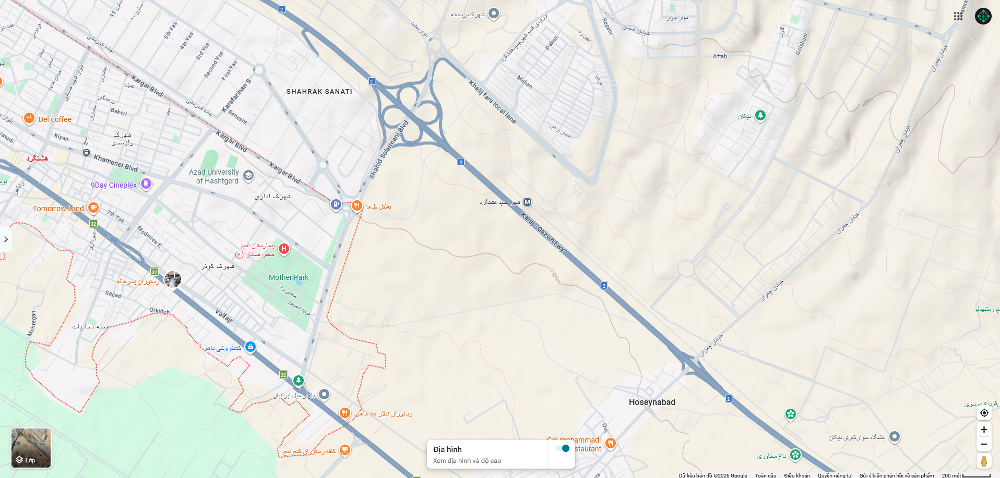

## Who ran

Flag: `d4rk{35.9546,50.7234}`

Challenge cung cấp cho chúng ta 1 ảnh trên đường cao tốc ở Iran, sau khi reverse searching bức ảnh thì chúng ta tìm ra được đoạn đường đó là đường cao tốc Karaj - Qazvin Fwy nằm cạnh khu công nghiệp Hashtgerd

## Phân tích biển quảng cáo

Khi dịch các chữ ở trên biển quảng cáo, dòng đỏ cho thấy rằng có 1 siêu thị Artiman nằm dưới cầu vượt cao tốc

Biển quảng cáo có chân bê tông cố định ở dưới

## Phân tích địa hình

Xung quanh cho thấy rằng địa điểm hiện tại có ít cây cối. Phía xa có thể thấy 1 tòa nhà có mái vòm cong

## Truy tìm địa điểm 

Sau khoảng 1 hồi tìm kiếm, mình tìm thấy được tọa độ chính xác của bức ảnh, trong đó manh mối tìm là: Khu công nghiệp Hashtgerg, đường cao tốc Karaj, gần đến cầu vượt

Sau khi dò quanh đoạn đường đó, chúng ta có thể tìm ra được biển quảng cáo, bên trái có 1 xe màu trắng cũng như phản chiếu của biển lên xe để tìm ra được tọa độ chính xác

[Link google map đến tọa độ trong challenge](https://www.google.com/maps/place/Hashtgerd,+Tehran,+Iran/@35.9545685,50.7236063,1309a,75y,307.09h,84.15t/data=!3m8!1e1!3m6!1sCIHM0ogKEICAgIDR7OezsQE!2e10!3e11!6shttps:%2F%2Flh3.googleusercontent.com%2Fgpms-cs-s%2FAM4Q-U9DNq3Xneehtjm43F1vFum5qgi_raqoki6wrXyUcv_HOgnzNCXGVW9seJiRpohKqPuXV7XhVDezsTSU-bfvwoOGhijdu2ZLZI_v1OC899_aCQrzWaOUrwI5Ng03eVbWvTbq8epGFQ%3Dw900-h600-k-no-pi5.850965503262486-ya209.90872457935848-ro0-fo100!7i5376!8i2688!4m6!3m5!1s0x3f8d0012927b228f:0x592c19cbee746066!8m2!3d35.9617252!4d50.6788343!16zL20vMDZxcTNz!5m1!1e4?entry=ttu&g_ep=EgoyMDI2MTExNi4wIKXMDSoASAFQAw%3D%3D)

Từ đó chúng ta tìm ra được flag là:
Flag: `d4rk{35.9546,50.7234}`